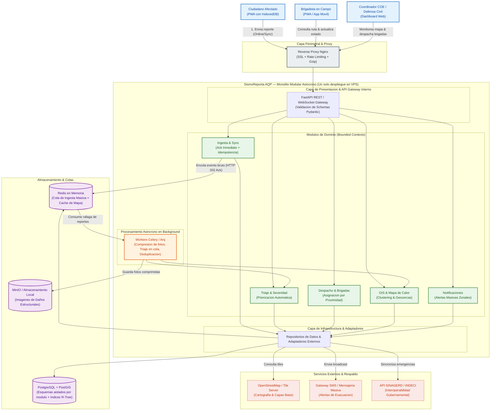
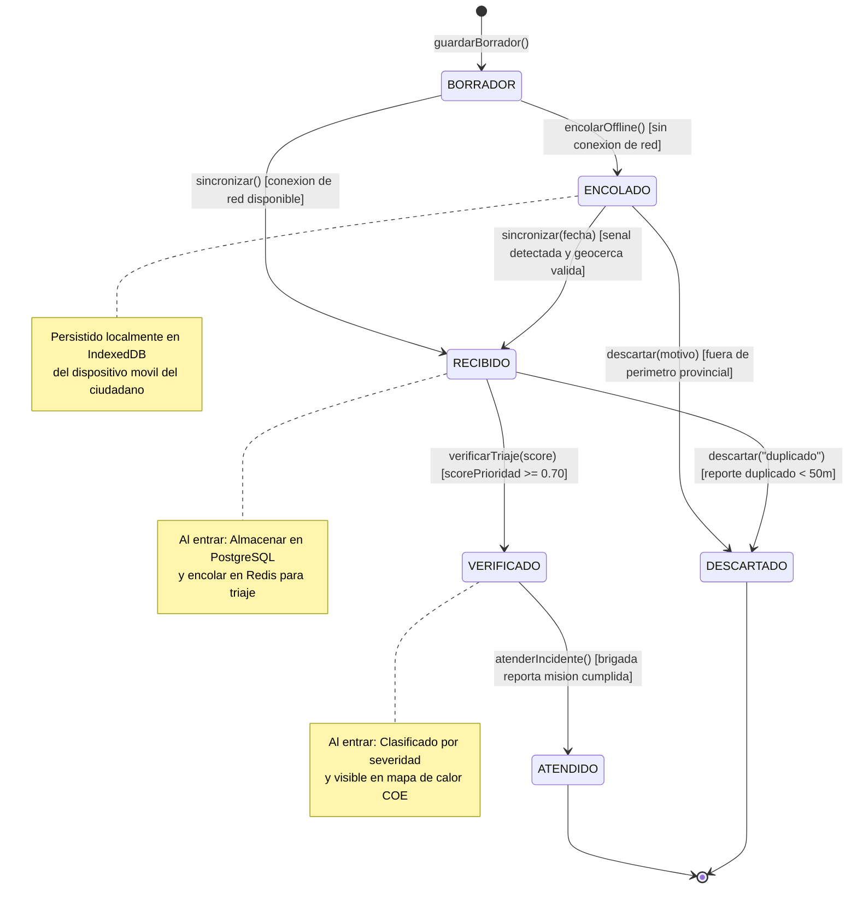
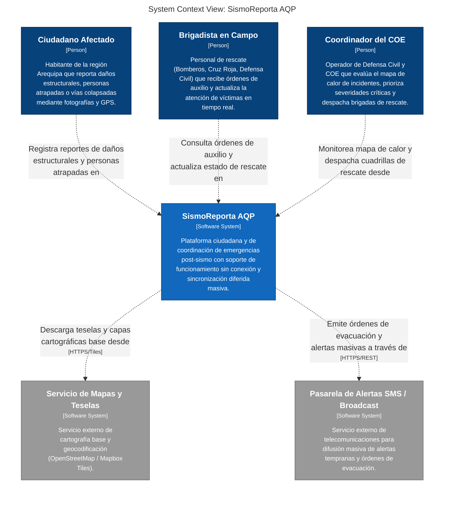
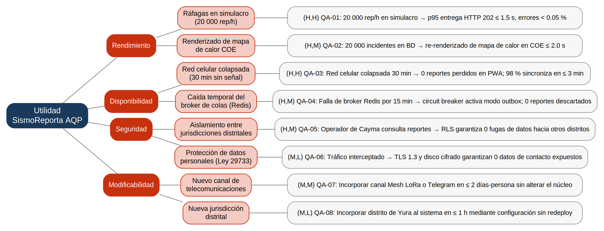
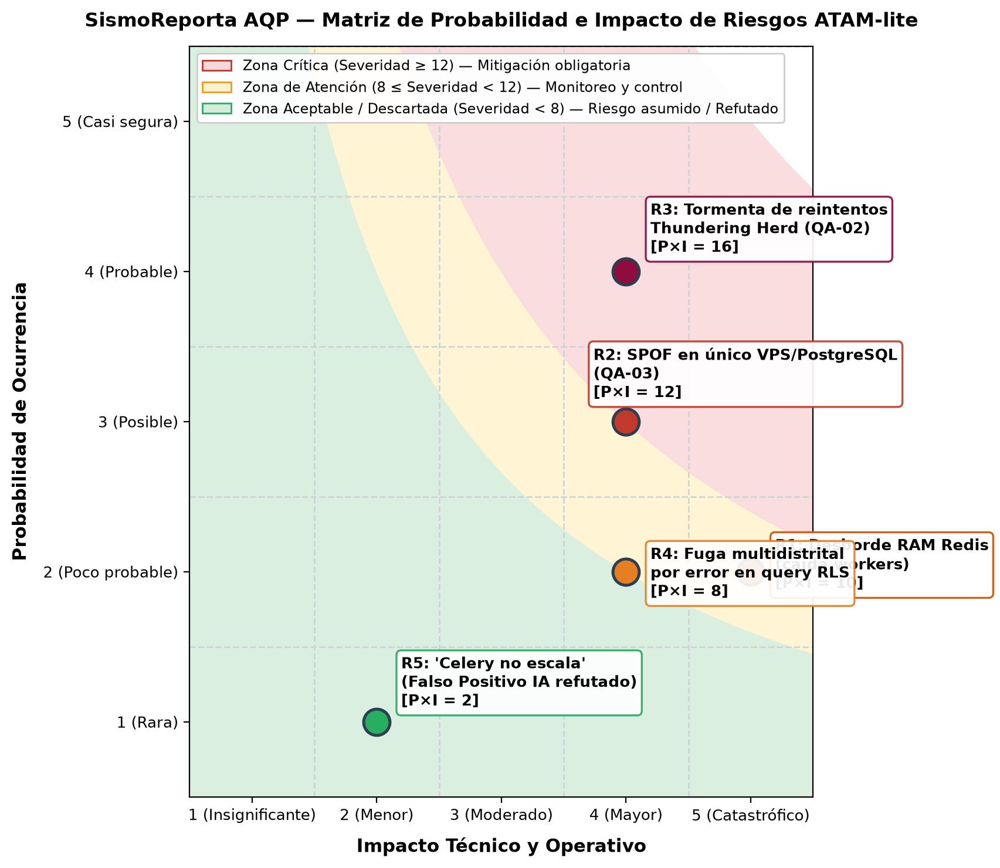

# SismoReporta AQP — Plataforma de Gestión y Coordinación de Emergencias
**Construcción de Software · EPIS-UNSA · 2026-B · Grupo 08**  
Docente: Mg. Alexander Javier Benavides Rojas

---

## Integrantes
| Nombre | Usuario GitHub | Correo Institucional | Rol en los Laboratorios |
| :--- | :---: | :---: | :--- |
| **Santiago Palma** | `@santiagopalma12` | `spalmaa@unsa.edu.pe` | Arquitecto de Software, Diagramador (Mermaid, Diagrams, Structurizr DSL), Autor de ADRs, Modelado de Clases y Secuencia. |
| **Dario Rafael Cornejo Hurtado** | `@darich1010` | `dcornejohu@unsa.edu.pe` | Especialista en Resiliencia y Datos, Diagramador C4-PlantUML, Auditor de Consistencia C1–C5 y Lista Oficial C4, Verificador de IA. |

---

## Caso 8: SismoReporta AQP
Plataforma ciudadana y de coordinación de emergencias para la región Arequipa tras un evento sísmico de gran magnitud. Permite a los ciudadanos afectados registrar reportes de colapsos estructurales, personas atrapadas y vías bloqueadas adjuntando fotografías comprimidas y geolocalización GPS, incluso sin conectividad a internet. El sistema consolida los incidentes en un tablero de comando con mapa de calor para que el Centro de Operaciones de Emergencia (COE) y Defensa Civil prioricen zonas de auxilio y despachen brigadas de rescate en función de la severidad del daño.  
**Atributo de Calidad Crítico:** *Disponibilidad y Rendimiento ante picos extremos:* Absorber hasta **20,000 reportes en la primera hora** con la red móvil colapsada o intermitente, garantizando **0 reportes perdidos** mediante persistencia local en el cliente (IndexedDB) y sincronización asíncrona diferida con latencia de aceptación $p95 \le 1.5\text{ s}$.

---

## Arquitectura Elegida: Monolito Modular Asíncrono
La arquitectura seleccionada organiza el sistema en un único artefacto desplegable en Python estructurado en módulos de dominio desacoplados (*Ingesta*, *Triaje*, *Brigadas*, *GIS*, *Notificaciones*), empleando **Redis** como buffer de ingesta masiva en memoria y workers en segundo plano (**Celery/arq**) para compresión multimedia y procesamiento geoespacial sobre **PostgreSQL + PostGIS**.



---

## Decisiones Arquitectónicas (ADRs)
- [ADR-001: Adopción de Monolito Modular Asíncrono con Colas en Memoria](docs/architecture/adr/001-estilo-arquitectonico.md)
- [ADR-002: Estrategia de Cliente Offline-First mediante PWA con Service Workers e IndexedDB](docs/architecture/adr/002-estrategia-offline-pwa.md)
- [ADR-003: Selección de PostgreSQL con Extensión Espacial PostGIS para Persistencia y Análisis Geoespacial](docs/architecture/adr/003-base-de-datos-postgis.md)

---

## Modelado y Diagramas del Sistema
* **Drivers y Escenarios de Calidad:** [docs/architecture/drivers.md](docs/architecture/drivers.md)
* **Matriz de Decisión Ponderada:** [docs/architecture/matriz-decision.md](docs/architecture/matriz-decision.md)
* **Diagrama de Arquitectura Elegida (Mermaid):** [docs/architecture/diagramas/arquitectura.mmd](docs/architecture/diagramas/arquitectura.mmd)
* **Alternativa B Descartada (PlantUML):** [docs/architecture/diagramas/alternativa.puml](docs/architecture/diagramas/alternativa.puml)
* **Vista de Despliegue de Infraestructura (Python Diagrams):** [docs/architecture/diagramas/despliegue.py](docs/architecture/diagramas/despliegue.py)
* **Vista de Despliegue en PlantUML:** [docs/architecture/diagramas/despliegue.puml](docs/architecture/diagramas/despliegue.puml)
* **Bitácora de Uso Crítico de IA:** [docs/architecture/bitacora-ia.md](docs/architecture/bitacora-ia.md)
* **Respuestas al Cuestionario Teórico:** [CUESTIONARIO.md](CUESTIONARIO.md)

---

## Reflexión sobre el uso de la IA (5 a 8 líneas)
Los asistentes de Inteligencia Artificial demostraron una gran agilidad para generar esqueletos de diagramas en sintaxis de código y redactar borradores iniciales de escenarios y ADRs. Sin embargo, su tendencia a recomendar por defecto soluciones hipercomplejas de moda (como microservicios serverless en AWS o clústeres de Kubernetes) requirió una postura crítica constante por parte del equipo para rechazar propuestas incompatibles con nuestro presupuesto de un único VPS y el plazo límite de 1 mes. Asimismo, la IA introdujo inconsistencias en capacidades reales de los navegadores (como asegurar falsamente soporte total de Background Sync en Safari iOS), lo que reforzó nuestro aprendizaje de contrastar siempre cada afirmación técnica contra la documentación oficial de ingeniería. En conclusión, la IA es un acelerador productivo excepcional para explorar opciones, pero el juicio arquitectónico final, la verificación empírica y la asunción de compromisos corresponden exclusivamente a los ingenieros.

---

## Diseño UML (Lab 05)

En este laboratorio se profundiza el diseño detallado del sistema mediante el paradigma **UML como Código (Diagram as Code)** versionado en Git, aplicando ingeniería directa e inversa con soporte crítico de Inteligencia Artificial y auditoría mediante las reglas de consistencia C1–C5.

### Entregables del Laboratorio
* **E1: Historia de Usuario y Diagrama de Clases:**  
  * Documento de Historia: [`docs/design/historia.md`](docs/design/historia.md)
  * Código PlantUML: [`docs/design/clases.puml`](docs/design/clases.puml)
  * Imagen Renderizada: [`docs/design/img/clases.png`](docs/design/img/clases.png)
* **E2: Diagrama de Secuencia del Flujo Crítico:**  
  * Código PlantUML: [`docs/design/secuencia-sincronizar-reporte.puml`](docs/design/secuencia-sincronizar-reporte.puml)
  * Imagen Renderizada: [`docs/design/img/secuencia-sincronizar-reporte.png`](docs/design/img/secuencia-sincronizar-reporte.png)
* **E3: Diagrama de Máquina de Estados:**  
  * Código Mermaid: [`docs/design/estados-reporte.mmd`](docs/design/estados-reporte.mmd)
  * Imagen Renderizada: [`docs/design/img/estados-reporte.png`](docs/design/img/estados-reporte.png)
* **E4: Diagrama de Actividades de Procesos:**  
  * Código PlantUML: [`docs/design/actividades-priorizar-asignar.puml`](docs/design/actividades-priorizar-asignar.puml)
  * Imagen Renderizada: [`docs/design/img/actividades-priorizar-asignar.png`](docs/design/img/actividades-priorizar-asignar.png)
* **E5: Diagrama de Paquetes Modulares:**  
  * Código PlantUML: [`docs/design/paquetes.puml`](docs/design/paquetes.puml)
  * Imagen Renderizada: [`docs/design/img/paquetes.png`](docs/design/img/paquetes.png)
* **E6: Round-Trip con IA e Ingeniería Inversa:**  
  * Código Fuente en Python: [`src/sismoreporta/dominio.py`](src/sismoreporta/dominio.py)
  * Diagrama Obtenido por Pyreverse: [`docs/design/classes_sismoreporta.puml`](docs/design/classes_sismoreporta.puml)
  * Imagen de Ingeniería Inversa: [`docs/design/img/classes_sismoreporta.png`](docs/design/img/classes_sismoreporta.png)
  * Análisis de Diferencias: [`docs/design/round-trip.md`](docs/design/round-trip.md)
* **E7: Auditoría de Consistencia y Bitácora de IA:**  
  * Matriz de Verificación C1–C5: [`docs/design/consistencia.md`](docs/design/consistencia.md)
  * Bitácora de Prompts e Interacciones Críticas: [`docs/design/bitacora-ia.md`](docs/design/bitacora-ia.md)
* **Cuestionario Teórico-Práctico:**  
  * Solución a las 8 Preguntas: [`CUESTIONARIO.md`](CUESTIONARIO.md)
* **Informe Formal:**  
  * Documento Typst compilable: [`informe_lab05.typ`](informe_lab05.typ)
  * Documento PDF final: [`informe_lab05.pdf`](informe_lab05.pdf)

---

### Diagrama de Máquina de Estados Embebido (E3 — Mermaid)



---

## Arquitectura C4 (Lab 06)

En este laboratorio se consolida la arquitectura del sistema mediante el **Modelo C4** y el paradigma de **Arquitectura como Código (Architecture as Code - AaC)** utilizando un modelo único y centralizado en **Structurizr DSL**, del cual se derivan coherentemente todas las vistas visuales hacia **C4-PlantUML** y **Mermaid**.

### Entregables del Laboratorio
* **E1: Inventario de Elementos y Diagrama de Contexto:**
  * Inventario de Elementos y Trazabilidad: [`docs/architecture/c4/inventario.md`](docs/architecture/c4/inventario.md)
  * Modelo Central en Structurizr DSL: [`docs/architecture/c4/workspace.dsl`](docs/architecture/c4/workspace.dsl)
  * Vista de Contexto (PlantUML): [`docs/architecture/c4/export/structurizr-Contexto.puml`](docs/architecture/c4/export/structurizr-Contexto.puml)
  * Imagen Renderizada: [`docs/architecture/c4/img/structurizr-Contexto.png`](docs/architecture/c4/img/structurizr-Contexto.png)
* **E2: Diagrama de Contenedores:**
  * Vista de Contenedores (PlantUML): [`docs/architecture/c4/export/structurizr-Contenedores.puml`](docs/architecture/c4/export/structurizr-Contenedores.puml)
  * Imagen Renderizada: [`docs/architecture/c4/img/structurizr-Contenedores.png`](docs/architecture/c4/img/structurizr-Contenedores.png)
* **E3: Diagrama de Componentes del API Backend:**
  * Vista de Componentes (PlantUML): [`docs/architecture/c4/export/structurizr-Componentes.puml`](docs/architecture/c4/export/structurizr-Componentes.puml)
  * Imagen Renderizada: [`docs/architecture/c4/img/structurizr-Componentes.png`](docs/architecture/c4/img/structurizr-Componentes.png)
* **E4: Vista Dinámica del Flujo Crítico de Sincronización:**
  * Vista Dinámica (PlantUML): [`docs/architecture/c4/export/structurizr-SincronizacionOffline.puml`](docs/architecture/c4/export/structurizr-SincronizacionOffline.puml)
  * Imagen Renderizada: [`docs/architecture/c4/img/structurizr-SincronizacionOffline.png`](docs/architecture/c4/img/structurizr-SincronizacionOffline.png)
  * Comparación Secuencia UML vs Dinámica C4: [`docs/architecture/c4/comparacion.md`](docs/architecture/c4/comparacion.md)
* **E5: Vista de Despliegue en Producción:**
  * Vista de Despliegue (PlantUML): [`docs/architecture/c4/export/structurizr-Despliegue.puml`](docs/architecture/c4/export/structurizr-Despliegue.puml)
  * Imagen Renderizada: [`docs/architecture/c4/img/structurizr-Despliegue.png`](docs/architecture/c4/img/structurizr-Despliegue.png)
* **E6: Exportación Multiformato y Comparación de Herramientas:**
  * Diagrama de Contexto Escrito a Mano: [`docs/architecture/c4/contexto-manual.puml`](docs/architecture/c4/contexto-manual.puml)
  * Imagen Renderizada del Contexto Manual: [`docs/architecture/c4/img/contexto-manual.png`](docs/architecture/c4/img/contexto-manual.png)
  * Análisis Comparativo (Manual vs DSL Centralizado): [`docs/architecture/c4/comparacion.md`](docs/architecture/c4/comparacion.md)
* **E7: Auditoría de Calidad Oficial, Explicación y Bitácora de IA:**
  * Lista de Revisión Oficial C4 y Falso Positivo: [`docs/architecture/c4/revision-c4.md`](docs/architecture/c4/revision-c4.md)
  * Explicación Ejecutiva No Técnica (<= 120 palabras): [`docs/architecture/c4/explicacion.md`](docs/architecture/c4/explicacion.md)
  * Bitácora de 5+ Interacciones con IA: [`docs/architecture/c4/bitacora-ia.md`](docs/architecture/c4/bitacora-ia.md)
* **E8: Cuestionario e Informe Formal:**
  * Solución al Cuestionario de 8 Preguntas: [`CUESTIONARIO.md`](CUESTIONARIO.md)
  * Documento Typst Compilable: [`informe_lab06.typ`](informe_lab06.typ)
  * Documento PDF Final: [`informe_lab06.pdf`](informe_lab06.pdf)

---

### Diagrama de Contexto Embebido (E8 — Mermaid exportado desde Structurizr DSL)



---

## Patrones de Diseño con IA (Lab 07)

En este laboratorio se refactoriza de forma segura el flujo crítico de *"Envío Offline y Sincronización Diferida de Reportes Post-Sismo"* hacia patrones de diseño GoF, midiendo objetivamente la reducción de complejidad ciclomática mediante **Radon**, blindando el comportamiento observable con **35 pruebas automatizadas en Pytest** y aislando un componente de IA no determinista (LLM) detrás de puertos, caché y una cadena de guardrails de dominio.

### Tabla Olor de Código → Patrón GoF → Prueba Demostrativa

| Olor Detectado (Fowler) | Patrón GoF Aplicado | Archivo de Implementación | Principio SOLID | Prueba Automatizada Demostrativa |
| :--- | :--- | :--- | :--- | :--- |
| **Método largo y $CC=22$:** `if/elif` por canal de red (`"REDIS"`, `"RABBITMQ"`, `"SMS_SATELITAL"`). | **Strategy + Factory (Registro)** | [`src/sismoreporta/canales.py`](src/sismoreporta/canales.py) | **O (Abierto/Cerrado)** | `test_open_closed_nuevo_canal_sin_modificar_servicio` (agrega `MeshLoraCanalAdapter` sin tocar el servicio). |
| **Acoplamiento a SDKs ajenos:** El dominio maneja JSON de Redis, bytes AMQP y hex de satélite. | **Adapter** | [`src/sismoreporta/canales.py`](src/sismoreporta/canales.py) | **D (Inversión Dependencias)** | `test_adapter_aisla_llamadas_especificas_del_sdk` (normaliza respuesta en `ResultadoDespacho`). |
| **Lógica duplicada:** Bucle de reintentos ante timeouts repetido en cada canal de red. | **Decorator (`ConReintentos`)** | [`src/sismoreporta/canales.py`](src/sismoreporta/canales.py) | **S (Responsabilidad Única)** | `test_reintenta_ante_dos_timeouts_y_logra_sincronizar` (recupera ante fallas transitorias). |
| **Condicionales sobre estado:** Evaluaciones anidadas sobre cadenas de `reporte.estado`. | **State** | [`src/sismoreporta/estados.py`](src/sismoreporta/estados.py) | **L (Liskov) / OCP** | `test_state_impide_transiciones_invalidas` (prohíbe transiciones ilegales por construcción). |
| **Notificaciones acopladas a mano:** Mensajes directos formateados para alertas COE y auditoría. | **Observer** | [`src/sismoreporta/eventos.py`](src/sismoreporta/eventos.py) | **S (Responsabilidad Única)** | `test_observer_nuevo_suscriptor_sin_tocar_servicio` (suscribe `TableroOperacionesMapa` desacoplado). |
| **Sincronización sin señal:** Falta de abstracción para encolar operaciones diferidas. | **Command + Cola** | [`src/sismoreporta/comandos.py`](src/sismoreporta/comandos.py) | **S (Responsabilidad Única)** | `test_command_cola_offline_encola_y_procesa_en_lote` (procesa ráfaga acumulada offline). |
| **IA No Confiable:** Respuestas probabilísticas con riesgo de alucinación o pánico social. | **Chain of Responsibility (Guardrails) + Decorator (Caché)** | [`src/sismoreporta/ia.py`](src/sismoreporta/ia.py) | **D (Inversión Dependencias)** | `test_guardrail_bloquea_alucinacion_de_magnitud`, `test_guardrail_bloquea_panico_social` y `test_decorator_cache_evita_llamadas_repetidas_al_llm`. |

### Tabla Comparativa de Métricas Radon (Antes vs Después)

| Métrica de Software | Versión ANTES (`antes/servicio.py`) | Versión DESPUÉS (`servicio.py` + módulos) | Impacto / Beneficio |
| :--- | :---: | :---: | :---: |
| **Complejidad Ciclomática Máxima (`sincronizar_reporte`)** | **22 (Rango D)** | **3 (Rango A)** | **-86.4% de complejidad** |
| **Complejidad Promedio de la Clase Principal** | **6.71 (Rango B)** | **1.93 (Rango A)** | **-71.2% (Código limpio)** |
| **Complejidad Promedio del Sistema Completo** | 6.71 (Rango B) | 2.04 (Rango A) | Rango A en todos los módulos |
| **Líneas de Código Lógicas (SLOC)** | 106 SLOC | 121 SLOC (`servicio.py`) / 480 SLOC (Total) | +352% (Alta modularidad) |
| **Índice de Mantenibilidad (MI)** | 52.93 (Rango A) | 58.73 (Rango A) | +10.9% (Menor acoplamiento) |
| **Total de Pruebas Unitarias y de Caracterización** | 12 pruebas | 35 pruebas en verde | 100% pruebas pasando |

### Entregables del Laboratorio 07
* **E1: Catálogo de Olores y Pruebas de Caracterización:** [`docs/design/patrones/olores.md`](docs/design/patrones/olores.md) y [`tests/test_comportamiento.py`](tests/test_comportamiento.py)
* **E2–E5: Módulos con Patrones GoF e IA:**
  * Canales (Strategy, Adapter, Decorator, Factory): [`src/sismoreporta/canales.py`](src/sismoreporta/canales.py)
  * Ciclo de Vida (State): [`src/sismoreporta/estados.py`](src/sismoreporta/estados.py)
  * Eventos (Observer) y Cola Offline (Command): [`src/sismoreporta/eventos.py`](src/sismoreporta/eventos.py) y [`src/sismoreporta/comandos.py`](src/sismoreporta/comandos.py)
  * IA Aislada (Guardrails Chain, Caché): [`src/sismoreporta/ia.py`](src/sismoreporta/ia.py)
  * Servicio Orquestador Refactorizado: [`src/sismoreporta/servicio.py`](src/sismoreporta/servicio.py)
  * Suite de Pruebas de Patrones: [`tests/test_patrones.py`](tests/test_patrones.py)
* **E6: Métricas y Trade-off Arquitectónico:** [`docs/design/patrones/metricas.md`](docs/design/patrones/metricas.md)
* **E7: Diagramas PlantUML y Bitácora de IA:**
  * Diagramas de Clases de Patrones: [`docs/design/patrones/`](docs/design/patrones/)
  * Diagrama de Clases General Actualizado: [`docs/design/clases.puml`](docs/design/clases.puml)
  * Bitácora de 6 Interacciones con IA: [`docs/design/patrones/bitacora-ia.md`](docs/design/patrones/bitacora-ia.md)
* **E8: ADR, Cuestionario e Informe Formal:**
  * Decisión Arquitectónica ADR-005: [`docs/architecture/adr/005-patrones-de-diseno.md`](docs/architecture/adr/005-patrones-de-diseno.md)
  * Solución al Cuestionario de 8 Preguntas: [`CUESTIONARIO.md`](CUESTIONARIO.md)
  * Documento Typst Compilable: [`informe_lab07.typ`](informe_lab07.typ)
  * Documento PDF Final: [`informe_lab07.pdf`](informe_lab07.pdf)
* **Reto Opcional (+2 puntos):** GitHub Action de Integración Continua ([`.github/workflows/patrones-ci.yml`](.github/workflows/patrones-ci.yml)) que ejecuta Pytest y falla si la complejidad ciclomática supera 10 (`radon cc --min C`).

---

## Diseño de la Arquitectura (Lab 08)

En este laboratorio se profundiza el diseño arquitectónico de **SismoReporta AQP** guiado por atributos de calidad mediante el método **Attribute-Driven Design (ADD 3.0)**, la priorización estricta a través de un **Árbol de Utilidad**, la evaluación de riesgos con **ATAM-lite** y la protección continua de la arquitectura mediante **Fitness Functions** automatizadas en Integración Continua (CI).

### 1. Árbol de Utilidad y Escenarios de Calidad

El árbol de utilidad estructura los atributos de calidad a partir del escenario de crecimiento del caso (**Simulacro Nacional: 20 000 reportes en 1 hora con red móvil congestionada**).



| ID | Atributo | Categoría / Táctica | Escenario de Calidad (Estímulo, Respuesta y Medida Numérica) | Importancia / Dificultad |
| :---: | :--- | :--- | :--- | :---: |
| **QA-01** | Rendimiento | Ingesta de Ráfagas | 20 000 ciudadanos emiten reportes en 1 hora durante el simulacro nacional bajo red 4G/3G congestionada (28 req/s pico); el sistema responde con Fast ACK con **$p95 \le 1.5\text{ s}$**. | **(H, H)** |
| **QA-02** | Disponibilidad | Resiliencia de Red | La red móvil presenta 8% de timeouts transitorios y el broker central sufre una caída de 20 min; el cliente retiene los datos y los sincroniza al volver el canal con **0 reportes perdidos**. | **(H, H)** |
| **QA-03** | Disponibilidad | Resiliencia de Servidor | El nodo VPS central sufre caída súbita o fallo del hipervisor; el sistema se reanuda desde snapshots automáticos con **$\text{MTTR} \le 15\text{ min}$**. | **(H, M)** |
| **QA-04** | Seguridad | Aislamiento Multidistrital | Un operador distrital consulta la API; el sistema aplica Row-Level Security (RLS) en PostgreSQL, garantizando **100% de aislamiento** distrital (0 filas expuestas a otras jurisdicciones). | **(H, M)** |
| **QA-05** | Modificabilidad | Nuevos Proveedores | Integrar un nuevo proveedor de mapas satelitales (IGN/Mapbox) o sensor acelerométrico (IGP) mediante puertos desacoplados con un esfuerzo **$\le 16\text{ horas-persona}$**. | **(M, M)** |
| **QA-06** | Rendimiento | Consultas Geoespaciales | Coordinadores del COE consultan el mapa de calor de intensidad Mercalli con 50 000 registros históricos; índice PostGIS GiST responde con **$p95 \le 500\text{ ms}$**. | **(M, L)** |
| **QA-07** | Seguridad | Mitigación de Spam/DDoS | Ataque o reportes falsos automatizados intentan inundar el gateway; NGINX aplica rate limiting conteniendo peticiones anómalas a **$< 50\text{ req/s}$ por IP**. | **(M, M)** |
| **QA-08** | Modificabilidad | Interoperabilidad INDECI | Exportar datos consolidados en formato GeoJSON/CAP estándar para el SINAGERD; esfuerzo de desarrollo **$\le 8\text{ horas-persona}$**. | **(L, L)** |

*Corrección Crítica a la IA:* La IA calificó inicialmente QA-06 como (H, H); el equipo la corrigió a (M, L) porque la consulta del mapa de calor no es el canal crítico de ingesta ciudadana de vida o muerte y su resolución mediante índices espaciales GiST es estándar en PostGIS.

---

### 2. Resumen de las Iteraciones de ADD 3.0

| Iteración | Escenario Objetivo | Elemento Refinado | Conceptos Evaluados | Táctica / Decisión Adoptada | Evidencia Cuantitativa |
| :---: | :---: | :--- | :--- | :--- | :--- |
| **Iteración 1** | **QA-01**<br/>(H, H)<br/>*Rendimiento* | Controlador REST de FastAPI y Capa de Ingesta | 1. Síncrono a 8 workers<br/>2. Kubernetes + Kafka (IA)<br/>**3. Buffer Redis + Fast ACK** | **Buffer Asíncrono en Redis (`LPUSH`) con Fast ACK HTTP 202.** Tareas pesadas diferidas a Celery + PostGIS GiST. (ADR-006). | Simulación M/G/c (`fitness/rendimiento.py`): a 28 req/s pico, **$p95 = 16.4\text{ ms}$** ($\rho = 0.07$), frente a $213.8\text{ s}$ sin buffer. |
| **Iteración 2** | **QA-02**<br/>(H, H)<br/>*Disponibilidad* | Cliente PWA y Broker de Despacho | 1. Sin tácticas<br/>2. Reintentos agresivos<br/>**3. Circuit Breaker + Outbox** | **Client-side Circuit Breaker (Decorator) + Local Outbox (IndexedDB) y Server Outbox (PostgreSQL ACID)** con Jitter aleatorio. (ADR-007). | Simulación Monte Carlo (`fitness/disponibilidad.py`): **0 reportes perdidos (100% éxito)** y llamadas inútiles al broker caído reducidas de 450 a 12 (**-97.3%**). |
| **Iteración 3** | **QA-04 / QA-05**<br/>(H, M / M, M)<br/>*Seguridad / Modif.* | Esquema de Persistencia y Puertos de Dominio | 1. 29 bases de datos (IA)<br/>2. 29 esquemas lógicos<br/>**3. Columna + PostgreSQL RLS** | **PostgreSQL Row-Level Security (RLS) con claims JWT** para aislamiento distrital y **Arquitectura Hexagonal** para puertos de mapas/sensores. (ADR-008). | Evaluación multicriterio (4.85/5.0); consumo de RAM en VPS $< 150\text{ MB}$; alta de distritos en $< 1\text{ s}$; verificación con FF-06. |

---

### 3. Matriz de Riesgos ATAM-lite y Mitigaciones



* **Riesgo R3 (Crítico - Sev 16):** *Tormenta de reintentos (Thundering Herd)* cuando 15 000 celulares reconectan simultáneamente tras el corte.  
  *Mitigación:* Circuit Breaker local conmuta a `ABIERTO` (*fail-fast*) + algoritmo de *Exponential Backoff con Jitter aleatorio* (5 a 60 s) + rate limiting en NGINX.
* **Riesgo R2 (Crítico - Sev 12):** *SPOF en instancia única de PostgreSQL / VPS*.  
  *Mitigación:* PWA Offline-First (los reportes se resguardan en IndexedDB de los celulares) + snapshots horarios automatizados en almacenamiento en bloque con $\text{MTTR} \le 15\text{ min}$.
* **Riesgo R1 (Atención - Sev 10):** *Desborde de RAM en Redis si Celery se cae*.  
  *Mitigación:* `maxmemory 512mb` con política `noeviction` y persistencia AOF en SSD (20 000 reportes insumen solo ~10 MB).
* **Riesgo R4 (Atención - Sev 8):** *Fuga de reportes confidenciales entre distritos por error en query*.  
  *Mitigación:* Política PostgreSQL RLS impuesta en el kernel relacional + fitness function FF-06 en CI.
* **Riesgo R5 (Falso Positivo Refutado - Sev 2):** *La IA afirmó que Celery y Python no escalan para 20 000 reportes en 1 hora*.  
  *Refutación con evidencia:* 20 000 reportes/h representan solo 5.56 req/s promedio (28 req/s pico). Con 4 workers Celery la capacidad del backend es de $> 400\text{ req/s}$ ($< 15\%$ CPU).

---

### 4. Fitness Functions Automatizadas en CI

Las fitness functions operan como compuerta de calidad obligatoria en GitHub Actions (`.github/workflows/fitness.yml`):

| ID | Tipo | Regla Arquitectural Protegida | Herramienta | Comando de Verificación |
| :---: | :---: | :--- | :---: | :--- |
| **FF-01** | Estructural | Capas del monolito modular sin ciclos de dependencias (ADR-001) | `import-linter` | `PYTHONPATH=src lint-imports` |
| **FF-02** | Estructural | Dominio y estados aislados de adaptadores y SDKs externos (ADR-005) | `import-linter` | `PYTHONPATH=src lint-imports` |
| **FF-03** | Calidad | Presupuesto de latencia en simulacro nacional: $p95 \le 1500\text{ ms}$ a 28 req/s (QA-01) | `pytest` | `pytest -v tests/test_fitness.py::test_ff03_rendimiento_simulacro_nacional` |
| **FF-04** | Calidad | Cero reportes perdidos ante intermitencia móvil y caída del broker (QA-02) | `pytest` | `pytest -v tests/test_fitness.py::test_ff04_cero_reportes_perdidos_ante_caida_del_broker` |
| **FF-05** | Calidad | Circuit Breaker reduce llamadas inútiles al broker caído en $> 80\%$ (Mitigación R3) | `pytest` | `pytest -v tests/test_fitness.py::test_ff05_breaker_protege_al_broker_caido` |
| **FF-06** | Calidad | Aislamiento estricto de reportes entre distritos mediante RLS (QA-04 / Mitigación R4) | `pytest` | `pytest -v tests/test_fitness.py::test_ff06_aislamiento_rls_distrital` |

---

## Cómo Reproducir el Proyecto

### 1. Requisitos del Entorno
* Python 3.10+ (probado en Python 3.11 y 3.14)
* Paquetes de validación: `pip install pytest import-linter matplotlib numpy cairosvg radon`
* Docker Engine (para Structurizr CLI y Graphviz/PlantUML)
* Typst CLI (`typst`)

### 2. Verificación de Fitness Functions y Suite de Pruebas (Lab 08)
```bash
# 1. Verificar contratos estructurales de capas (FF-01 y FF-02)
PYTHONPATH=src lint-imports

# 2. Ejecutar fitness functions arquitecturales de calidad (FF-03 a FF-06)
PYTHONPATH=src:. pytest -v tests/test_fitness.py

# 3. Ejecutar suite completa de pruebas (39 tests: comportamiento, patrones y fitness)
PYTHONPATH=src:. pytest -v tests/
```

### 3. Ejecución de Simulaciones Cuantitativas
```bash
# Simulación de teoría de colas M/G/c (Rendimiento QA-01)
python3 fitness/rendimiento.py

# Simulación estocástica Monte Carlo (Disponibilidad QA-02)
python3 fitness/disponibilidad.py

# Generación de matriz de riesgos ATAM-lite
python3 fitness/matriz_riesgos.py
```

### 4. Validación del Modelo C4 con Etiquetas [QA-xx]
```bash
docker run --rm -v "$PWD":/usr/local/structurizr structurizr/cli validate -w docs/architecture/c4/workspace.dsl
```

### 5. Compilación de Informes Formales en Typst
```bash
# Compilar informe del Laboratorio 05
typst compile informe_lab05.typ informe_lab05.pdf

# Compilar informe del Laboratorio 06
typst compile informe_lab06.typ informe_lab06.pdf

# Compilar informe del Laboratorio 07
typst compile informe_lab07.typ informe_lab07.pdf

# Compilar informe del Laboratorio 08
typst compile informe_lab08.typ informe_lab08.pdf
```


