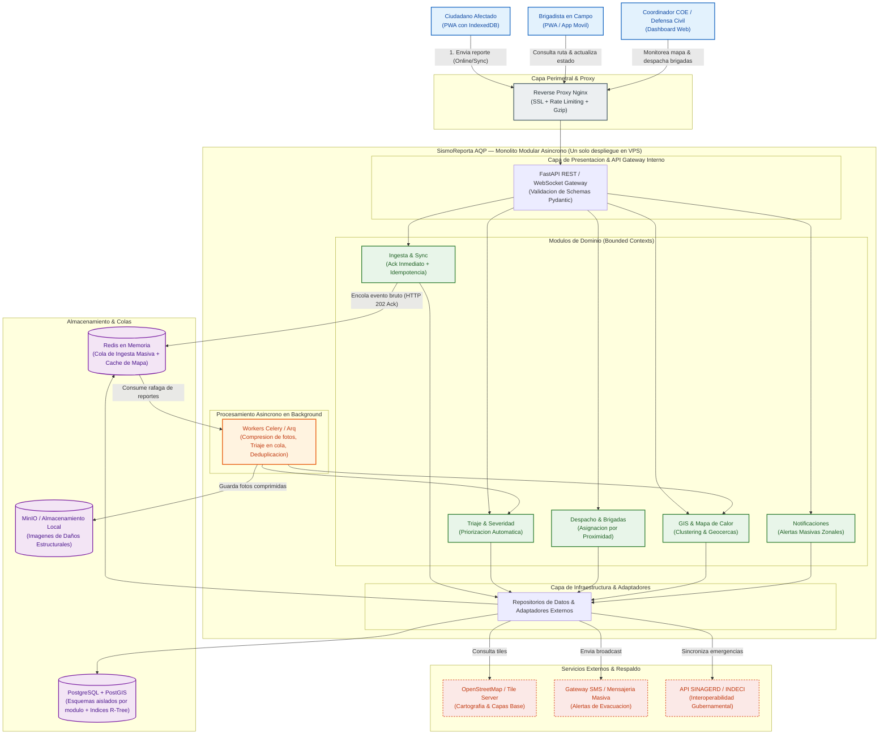
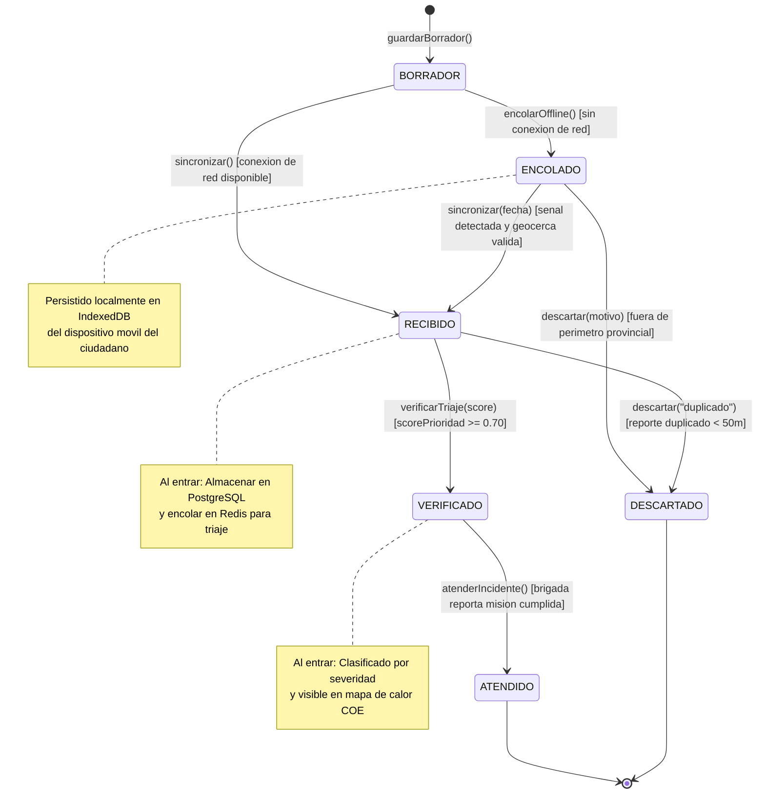
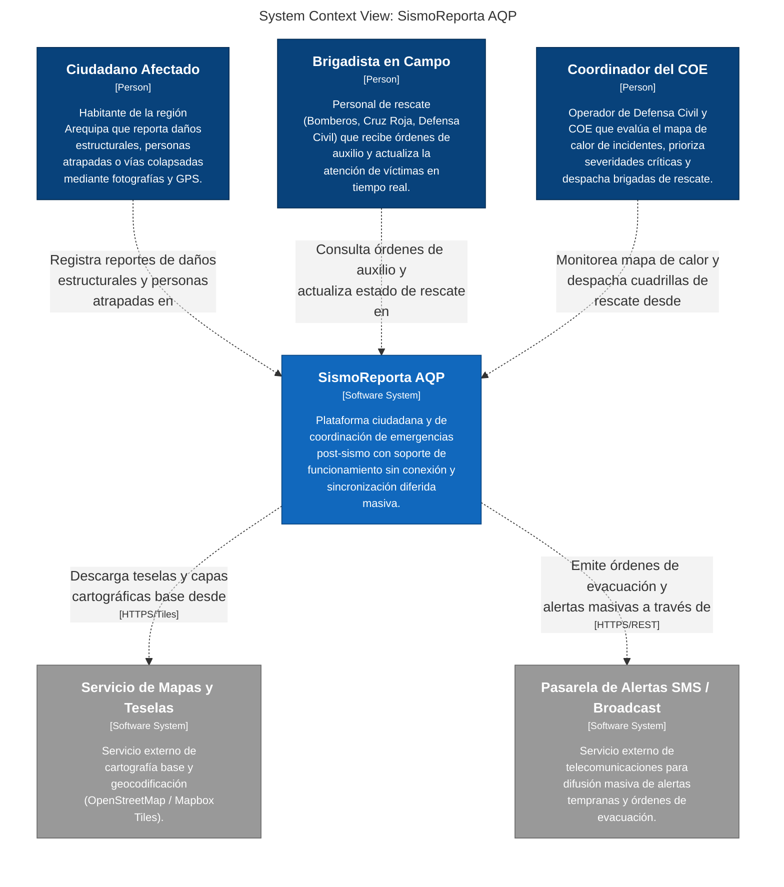

# SismoReporta AQP — Plataforma de Gestión y Coordinación de Emergencias
**Construcción de Software · EPIS-UNSA · 2026-B · Grupo 08**  
Docente: Mg. Antonio Arroyo Paz

---

## Integrantes
| Nombre | Usuario GitHub | Correo Institucional | Rol en los Laboratorios |
| :--- | :---: | :---: | :--- |
| **Santiago Palma** | `@santiagopalma12` | `spalmaa@unsa.edu.pe` | Arquitecto de Software, Diagramador (Mermaid, Diagrams, Structurizr DSL), Autor de ADRs, Modelado de Clases y Secuencia. |
| **Dario Rafael Cornejo Hurtado** | `@darich1010` | `dcornejohu@unsa.edu.pe` | Especialista en Resiliencia y Datos, Diagramador C4-PlantUML, Auditor de Consistencia C1–C5 y Lista Oficial C4, Verificador de IA. |

---

## Caso 8: SismoReporta AQP
Plataforma ciudadana y de coordinación de emergencias para la región Arequipa tras un evento sísmico de gran magnitud. Permite a los ciudadanos afectados registrar reportes de colapsos estructurales, personas atrapadas y vías bloqueadas adjuntando fotografías comprimidas y geolocalización GPS, incluso sin conectividad a internet. El sistema consolida los incidentes en un tablero de comando con mapa de calor para que el Centro de Operaciones de Emergencia (COE) y Defensa Civil prioricen zonas de auxilio y despachen brigadas de rescate en función de la severidad del daño.  
**Atributo de Calidad Crítico:** *Disponibilidad y Rendimiento ante picos extremos:* Absorber hasta **20,000 reportes en la primera hora** con la red móvil colapsada o intermitente, garantizando **0 reportes perdidos** mediante persistencia local en el cliente (IndexedDB) y sincronización asíncrona diferida con latencia de aceptación $p95 \le 1.5\text{ s}$.

---

## Arquitectura Elegida: Monolito Modular Asíncrono
La arquitectura seleccionada organiza el sistema en un único artefacto desplegable en Python estructurado en módulos de dominio desacoplados (*Ingesta*, *Triaje*, *Brigadas*, *GIS*, *Notificaciones*), empleando **Redis** como buffer de ingesta masiva en memoria y workers en segundo plano (**Celery/arq**) para compresión multimedia y procesamiento geoespacial sobre **PostgreSQL + PostGIS**.



---

## Decisiones Arquitectónicas (ADRs)
- [ADR-001: Adopción de Monolito Modular Asíncrono con Colas en Memoria](docs/architecture/adr/001-estilo-arquitectonico.md)
- [ADR-002: Estrategia de Cliente Offline-First mediante PWA con Service Workers e IndexedDB](docs/architecture/adr/002-estrategia-offline-pwa.md)
- [ADR-003: Selección de PostgreSQL con Extensión Espacial PostGIS para Persistencia y Análisis Geoespacial](docs/architecture/adr/003-base-de-datos-postgis.md)

---

## Modelado y Diagramas del Sistema
* **Drivers y Escenarios de Calidad:** [docs/architecture/drivers.md](docs/architecture/drivers.md)
* **Matriz de Decisión Ponderada:** [docs/architecture/matriz-decision.md](docs/architecture/matriz-decision.md)
* **Diagrama de Arquitectura Elegida (Mermaid):** [docs/architecture/diagramas/arquitectura.mmd](docs/architecture/diagramas/arquitectura.mmd)
* **Alternativa B Descartada (PlantUML):** [docs/architecture/diagramas/alternativa.puml](docs/architecture/diagramas/alternativa.puml)
* **Vista de Despliegue de Infraestructura (Python Diagrams):** [docs/architecture/diagramas/despliegue.py](docs/architecture/diagramas/despliegue.py)
* **Vista de Despliegue en PlantUML:** [docs/architecture/diagramas/despliegue.puml](docs/architecture/diagramas/despliegue.puml)
* **Bitácora de Uso Crítico de IA:** [docs/architecture/bitacora-ia.md](docs/architecture/bitacora-ia.md)
* **Respuestas al Cuestionario Teórico:** [CUESTIONARIO.md](CUESTIONARIO.md)

---

## Reflexión sobre el uso de la IA (5 a 8 líneas)
Los asistentes de Inteligencia Artificial demostraron una gran agilidad para generar esqueletos de diagramas en sintaxis de código y redactar borradores iniciales de escenarios y ADRs. Sin embargo, su tendencia a recomendar por defecto soluciones hipercomplejas de moda (como microservicios serverless en AWS o clústeres de Kubernetes) requirió una postura crítica constante por parte del equipo para rechazar propuestas incompatibles con nuestro presupuesto de un único VPS y el plazo límite de 1 mes. Asimismo, la IA introdujo inconsistencias en capacidades reales de los navegadores (como asegurar falsamente soporte total de Background Sync en Safari iOS), lo que reforzó nuestro aprendizaje de contrastar siempre cada afirmación técnica contra la documentación oficial de ingeniería. En conclusión, la IA es un acelerador productivo excepcional para explorar opciones, pero el juicio arquitectónico final, la verificación empírica y la asunción de compromisos corresponden exclusivamente a los ingenieros.

---

## Diseño UML (Lab 05)

En este laboratorio se profundiza el diseño detallado del sistema mediante el paradigma **UML como Código (Diagram as Code)** versionado en Git, aplicando ingeniería directa e inversa con soporte crítico de Inteligencia Artificial y auditoría mediante las reglas de consistencia C1–C5.

### Entregables del Laboratorio
* **E1: Historia de Usuario y Diagrama de Clases:**  
  * Documento de Historia: [`docs/design/historia.md`](docs/design/historia.md)
  * Código PlantUML: [`docs/design/clases.puml`](docs/design/clases.puml)
  * Imagen Renderizada: [`docs/design/img/clases.png`](docs/design/img/clases.png)
* **E2: Diagrama de Secuencia del Flujo Crítico:**  
  * Código PlantUML: [`docs/design/secuencia-sincronizar-reporte.puml`](docs/design/secuencia-sincronizar-reporte.puml)
  * Imagen Renderizada: [`docs/design/img/secuencia-sincronizar-reporte.png`](docs/design/img/secuencia-sincronizar-reporte.png)
* **E3: Diagrama de Máquina de Estados:**  
  * Código Mermaid: [`docs/design/estados-reporte.mmd`](docs/design/estados-reporte.mmd)
  * Imagen Renderizada: [`docs/design/img/estados-reporte.png`](docs/design/img/estados-reporte.png)
* **E4: Diagrama de Actividades de Procesos:**  
  * Código PlantUML: [`docs/design/actividades-priorizar-asignar.puml`](docs/design/actividades-priorizar-asignar.puml)
  * Imagen Renderizada: [`docs/design/img/actividades-priorizar-asignar.png`](docs/design/img/actividades-priorizar-asignar.png)
* **E5: Diagrama de Paquetes Modulares:**  
  * Código PlantUML: [`docs/design/paquetes.puml`](docs/design/paquetes.puml)
  * Imagen Renderizada: [`docs/design/img/paquetes.png`](docs/design/img/paquetes.png)
* **E6: Round-Trip con IA e Ingeniería Inversa:**  
  * Código Fuente en Python: [`src/sismoreporta/dominio.py`](src/sismoreporta/dominio.py)
  * Diagrama Obtenido por Pyreverse: [`docs/design/classes_sismoreporta.puml`](docs/design/classes_sismoreporta.puml)
  * Imagen de Ingeniería Inversa: [`docs/design/img/classes_sismoreporta.png`](docs/design/img/classes_sismoreporta.png)
  * Análisis de Diferencias: [`docs/design/round-trip.md`](docs/design/round-trip.md)
* **E7: Auditoría de Consistencia y Bitácora de IA:**  
  * Matriz de Verificación C1–C5: [`docs/design/consistencia.md`](docs/design/consistencia.md)
  * Bitácora de Prompts e Interacciones Críticas: [`docs/design/bitacora-ia.md`](docs/design/bitacora-ia.md)
* **Cuestionario Teórico-Práctico:**  
  * Solución a las 8 Preguntas: [`CUESTIONARIO.md`](CUESTIONARIO.md)
* **Informe Formal:**  
  * Documento Typst compilable: [`informe_lab05.typ`](informe_lab05.typ)
  * Documento PDF final: [`informe_lab05.pdf`](informe_lab05.pdf)

---

### Diagrama de Máquina de Estados Embebido (E3 — Mermaid)



---

## Arquitectura C4 (Lab 06)

En este laboratorio se consolida la arquitectura del sistema mediante el **Modelo C4** y el paradigma de **Arquitectura como Código (Architecture as Code - AaC)** utilizando un modelo único y centralizado en **Structurizr DSL**, del cual se derivan coherentemente todas las vistas visuales hacia **C4-PlantUML** y **Mermaid**.

### Entregables del Laboratorio
* **E1: Inventario de Elementos y Diagrama de Contexto:**
  * Inventario de Elementos y Trazabilidad: [`docs/architecture/c4/inventario.md`](docs/architecture/c4/inventario.md)
  * Modelo Central en Structurizr DSL: [`docs/architecture/c4/workspace.dsl`](docs/architecture/c4/workspace.dsl)
  * Vista de Contexto (PlantUML): [`docs/architecture/c4/export/structurizr-Contexto.puml`](docs/architecture/c4/export/structurizr-Contexto.puml)
  * Imagen Renderizada: [`docs/architecture/c4/img/structurizr-Contexto.png`](docs/architecture/c4/img/structurizr-Contexto.png)
* **E2: Diagrama de Contenedores:**
  * Vista de Contenedores (PlantUML): [`docs/architecture/c4/export/structurizr-Contenedores.puml`](docs/architecture/c4/export/structurizr-Contenedores.puml)
  * Imagen Renderizada: [`docs/architecture/c4/img/structurizr-Contenedores.png`](docs/architecture/c4/img/structurizr-Contenedores.png)
* **E3: Diagrama de Componentes del API Backend:**
  * Vista de Componentes (PlantUML): [`docs/architecture/c4/export/structurizr-Componentes.puml`](docs/architecture/c4/export/structurizr-Componentes.puml)
  * Imagen Renderizada: [`docs/architecture/c4/img/structurizr-Componentes.png`](docs/architecture/c4/img/structurizr-Componentes.png)
* **E4: Vista Dinámica del Flujo Crítico de Sincronización:**
  * Vista Dinámica (PlantUML): [`docs/architecture/c4/export/structurizr-SincronizacionOffline.puml`](docs/architecture/c4/export/structurizr-SincronizacionOffline.puml)
  * Imagen Renderizada: [`docs/architecture/c4/img/structurizr-SincronizacionOffline.png`](docs/architecture/c4/img/structurizr-SincronizacionOffline.png)
  * Comparación Secuencia UML vs Dinámica C4: [`docs/architecture/c4/comparacion.md`](docs/architecture/c4/comparacion.md)
* **E5: Vista de Despliegue en Producción:**
  * Vista de Despliegue (PlantUML): [`docs/architecture/c4/export/structurizr-Despliegue.puml`](docs/architecture/c4/export/structurizr-Despliegue.puml)
  * Imagen Renderizada: [`docs/architecture/c4/img/structurizr-Despliegue.png`](docs/architecture/c4/img/structurizr-Despliegue.png)
* **E6: Exportación Multiformato y Comparación de Herramientas:**
  * Diagrama de Contexto Escrito a Mano: [`docs/architecture/c4/contexto-manual.puml`](docs/architecture/c4/contexto-manual.puml)
  * Imagen Renderizada del Contexto Manual: [`docs/architecture/c4/img/contexto-manual.png`](docs/architecture/c4/img/contexto-manual.png)
  * Análisis Comparativo (Manual vs DSL Centralizado): [`docs/architecture/c4/comparacion.md`](docs/architecture/c4/comparacion.md)
* **E7: Auditoría de Calidad Oficial, Explicación y Bitácora de IA:**
  * Lista de Revisión Oficial C4 y Falso Positivo: [`docs/architecture/c4/revision-c4.md`](docs/architecture/c4/revision-c4.md)
  * Explicación Ejecutiva No Técnica (<= 120 palabras): [`docs/architecture/c4/explicacion.md`](docs/architecture/c4/explicacion.md)
  * Bitácora de 5+ Interacciones con IA: [`docs/architecture/c4/bitacora-ia.md`](docs/architecture/c4/bitacora-ia.md)
* **E8: Cuestionario e Informe Formal:**
  * Solución al Cuestionario de 8 Preguntas: [`CUESTIONARIO.md`](CUESTIONARIO.md)
  * Documento Typst Compilable: [`informe_lab06.typ`](informe_lab06.typ)
  * Documento PDF Final: [`informe_lab06.pdf`](informe_lab06.pdf)

---

### Diagrama de Contexto Embebido (E8 — Mermaid exportado desde Structurizr DSL)



---

## Cómo Reproducir el Proyecto

### 1. Requisitos del Entorno
* Python 3.10+
* OpenJDK 17+ (Java 25 probado)
* Structurizr CLI (`structurizr.sh`) o imagen Docker `structurizr/cli`
* PlantUML y Graphviz (`plantuml.jar` o Docker `plantuml/plantuml`)
* Typst CLI (`typst`)
* Pylint / Pyreverse (`pip install pylint`)

### 2. Validación y Exportación de la Arquitectura C4 (Lab 06)
```bash
# Validar la consistencia semántica del modelo DSL
structurizr.sh validate -w docs/architecture/c4/workspace.dsl

# Exportar el modelo a C4-PlantUML y Mermaid
structurizr.sh export -w docs/architecture/c4/workspace.dsl -f plantuml/c4plantuml -o docs/architecture/c4/export
structurizr.sh export -w docs/architecture/c4/workspace.dsl -f mermaid -o docs/architecture/c4/export

# Renderizar diagramas a imágenes PNG de alta resolución
docker run --rm -v "$PWD":/work -w /work plantuml/plantuml "docs/architecture/c4/export/*.puml" -o ../img/
docker run --rm -v "$PWD":/work -w /work plantuml/plantuml docs/architecture/c4/contexto-manual.puml -o img/
```

### 3. Renderizado de Diagramas UML (Lab 05)
```bash
java -jar plantuml.jar -tpng docs/design/clases.puml -o img/
java -jar plantuml.jar -tpng docs/design/secuencia-sincronizar-reporte.puml -o img/
java -jar plantuml.jar -tpng docs/design/actividades-priorizar-asignar.puml -o img/
java -jar plantuml.jar -tpng docs/design/paquetes.puml -o img/
java -jar plantuml.jar -tpng docs/design/estados-reporte.puml -o img/
```

### 4. Compilación de Informes Formales en Typst
```bash
# Compilar informe del Laboratorio 05
typst compile informe_lab05.typ informe_lab05.pdf

# Compilar informe del Laboratorio 06
typst compile informe_lab06.typ informe_lab06.pdf
```

