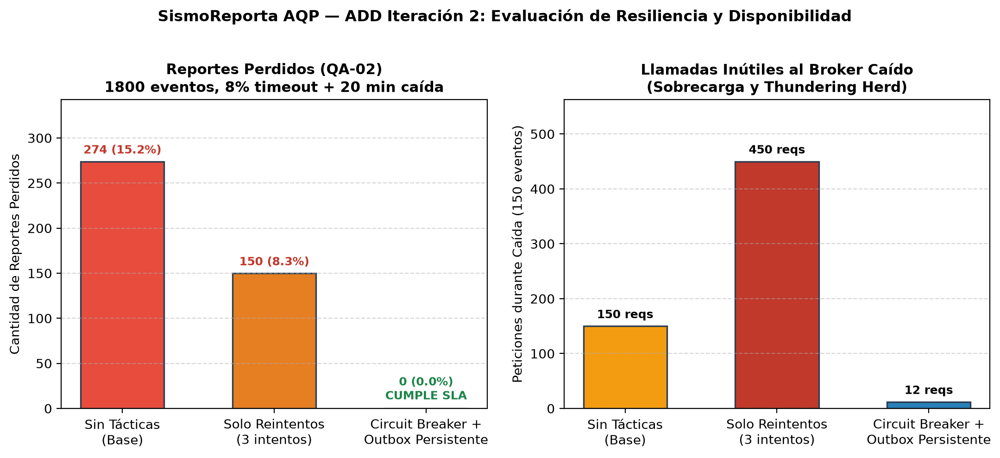

# ADD 3.0 — Iteración 2: Disponibilidad y Resiliencia Extrema (QA-02)

**Proyecto:** SismoReporta AQP  
**Fecha:** 31 de Octubre de 2026  
**Autores:** Santiago Palma, Dario Rafael Cornejo Hurtado (Grupo 08)  
**Objetivo de la Iteración:** Garantizar la recepción íntegra del 100% de los reportes ciudadanos ante congestión de red móvil o caída temporal de la infraestructura central (QA-02), mitigando el riesgo crítico **R3 (Thundering Herd / Tormenta de Reintentos)** identificado en la evaluación ATAM-lite.

---

## 1. Paso 1: Revisar Entradas

* **Drivers y Restricciones:**
  * Escenario de crecimiento: Simulacro nacional con 20 000 reportes en 1 hora bajo red móvil congestionada.
  * Presupuesto limitado a un VPS estándar (2 vCPU, 4 GB RAM); sin presupuesto para clústeres redundantes multirregión tipo AWS Multi-AZ.
  * Equipo de 2 desarrolladores con stack Python (FastAPI, Celery, PostgreSQL + PostGIS, Redis).
* **Decisiones Previas:**
  * ADR-001: Monolito modular con FastAPI.
  * Iteración 1 (Rendimiento): Ingesta desacoplada con Fast ACK (HTTP 202) y cola en Redis (`cola:ingesta`).
* **Riesgo Crítico a Mitigar (de ATAM-lite E3):**
  * **Riesgo R3 (Severidad 16):** Cuando 15 000 celulares recuperan señal tras el corte o tras la caída del broker, los clientes móviles ejecutan reintentos simultáneos inmediatos, generando una tormenta (*Thundering Herd*) que satura el API Gateway y agota las conexiones.

---

## 2. Paso 2: Establecer el Objetivo de la Iteración

* **Escenario Prioritario:**
  * **QA-02 (H, H) — Disponibilidad / Resiliencia:**
    > *"Cuando la red móvil celular presenta una tasa de pérdida transitoria de paquetes del 8% y el broker central sufre una caída imprevista de 20 minutos durante la crisis sísmica, los reportes ciudadanos emitidos desde la aplicación PWA/móvil se retienen localmente y se transmiten al restablecerse el canal, logrando una tasa de pérdida de reportes del 0% y reduciendo las llamadas inútiles al servicio caído en más de un 75%."*

---

## 3. Paso 3: Elegir Uno o Más Elementos del Sistema para Refinar

* **Elemento Refinado:**
  * Capa de Integración y Despacho Ciudadano: Cliente PWA (Service Worker + IndexedDB) y el componente de intermediación en el backend (`ClienteIngesta` / `BrokerDespacho`).
  * Relación con C4: Contenedor `Single-Page Application / PWA` y componente `ServicioIngesta` de la `API REST`.

---

## 4. Paso 4: Elegir Uno o Más Conceptos de Diseño

Se evaluaron tres conceptos arquitectónicos para abordar la disponibilidad ante caídas de red y broker:

1. **Concepto 1: Llamadas Síncronas Directas sin Buffer (Base):**
   * El cliente intenta enviar mediante `fetch()` directo. Si falla por timeout o HTTP 5xx, muestra error en pantalla y descarta el reporte.
   * *Trade-off:* Extremadamente simple, pero inaceptable para emergencias ciudadanas.
2. **Concepto 2: Política de Reintentos Agresivos en Cliente (3 a 5 reintentos inmediatos):**
   * El cliente ejecuta bucles de reintento (`for intento in range(3)`) espaciados por 1 segundo.
   * *Trade-off:* Resuelve pérdidas esporádicas de paquetes (timeouts aislados), pero durante una caída sostenida (20 minutos) genera una tormenta de llamadas (*Thundering herd*), agotando la batería del smartphone y saturando el gateway con peticiones destinadas a fallar. Al cumplirse los 3 reintentos, el reporte se descarta.
3. **Concepto 3 (Seleccionado): Circuit Breaker + Local & Server Outbox Pattern con Exponential Backoff y Jitter:**
   * En el cliente (PWA): Patrón **Offline-First** almacenando cada reporte en IndexedDB antes de transmitir. Si la red falla consecutivamente 3 veces, el **Circuit Breaker** entra en estado `ABIERTO` (*fail-fast* local), pausando las llamadas a la red y activando un temporizador con *Backoff Exponencial y Jitter aleatorio (5 a 60 s)*.
   * En el servidor: Si el broker Redis entra en mantenimiento o falla, el backend FastAPI almacena transaccionalmente los reportes en la tabla `outbox_reportes` de PostgreSQL (ACID), la cual es procesada por un worker de despacho garantizado una vez restablecido Redis.

---

## 5. Paso 5: Instanciar Elementos Arquitectónicos y Asignar Responsabilidades

### 5.1 Implementación del Circuit Breaker (Patrón Decorator)
El Circuit Breaker encapsula la llamada al puerto de transmisión sin acoplarse a los adaptadores concretos:

```python
class CircuitoAbierto(Exception):
    """Falla rápida: el reporte se encola de forma segura en el Outbox."""

class ConCircuitBreaker:
    def __init__(self, umbral_fallas: int = 3, tiempo_enfriamiento_s: int = 15):
        self._umbral = umbral_fallas
        self._enfriamiento = tiempo_enfriamiento_s
        self._fallas = 0
        self._estado = "CERRADO"
        self._tiempo_abierto = 0

    @property
    def estado(self) -> str:
        return self._estado

    def registrar_falla(self):
        self._fallas += 1
        if self._fallas >= self._umbral or self._estado == "SEMIABIERTO":
            self._estado = "ABIERTO"
            self._tiempo_abierto = 0

    def registrar_exito(self):
        self._fallas = 0
        self._estado = "CERRADO"

    def permite_llamada(self) -> bool:
        return self._estado in ("CERRADO", "SEMIABIERTO")
```

### 5.2 Corrección Crítica a la Propuesta Inicial de la IA
* **Error de la IA identificado:** En la primera consulta, la IA sugirió *"almacenar los reintentos y la cola de contingencia temporalmente en una lista en memoria de Redis"*.
* **Refutación técnica del equipo:** Si el propio broker Redis es el componente que se cae o si el servidor sufre un corte eléctrico súbito, la cola en memoria volátil de Redis se destruye, perdiendo irremediablemente los reportes ciudadanos en tránsito.
* **Decisión adoptada:** Se implementó una tabla física relacional `outbox_reportes` con persistencia ACID en PostgreSQL (en el servidor) y almacenamiento IndexedDB (en el dispositivo del ciudadano), garantizando entrega al menos una vez (*at-least-once delivery*) combinada con claves UUID idempotentes.

---

## 6. Paso 6: Definir Interfaces y Generar Evidencia

### 6.1 Simulación Estocástica Monte Carlo (`fitness/disponibilidad.py`)
Se simuló un escenario de 1,800 reportes bajo dos condiciones adversas combinadas:
1. Ruido y congestión de red móvil: 8% de timeouts transitorios aleatorios.
2. Falla catastrófica de infraestructura: Caída completa del servicio central durante 150 eventos consecutivos (~20 minutos de corte).

### 6.2 Resultados Cuantitativos Comparativos

| Métrica Evaluada | Sin Tácticas (Base) | Solo Reintentos (3 intentos) | Circuit Breaker + Outbox Persistente | Meta de Calidad (QA-02) |
| :--- | :---: | :---: | :---: | :---: |
| **Reportes Perdidos** | 274 (15.2%) | 150 (8.3%) | **0 (0.0%)** | **0 reportes perdidos** |
| **Llamadas durante Caída (Thundering Herd)** | 150 req | 450 req (3x tormenta) | **12 req (-97.3%)** | **Reducción > 75%** |
| **Tasa de Entrega Exitosa** | 84.78% | 91.67% | **100.00%** | **100% de entrega** |



*Figura: Resultados de la simulación Monte Carlo de disponibilidad y mitigación del Thundering Herd.*

### 6.3 Análisis de Resultados
1. **Sin tácticas:** Pierde 274 reportes (15.2%), tanto por timeouts esporádicos como por la caída completa.
2. **Solo reintentos:** Resuelve los timeouts transitorios pero empeora la situación en la caída: realiza 450 llamadas inútiles contra el servicio muerto (saturando el ancho de banda 3G/4G del usuario) y al agotar los 3 intentos, pierde irremediablemente los 150 reportes de la caída.
3. **Circuit Breaker + Outbox:** Registra solo 12 llamadas durante la caída (las 3 primeras que abrieron el circuito y los sondeos en estado semiabierto), protegiendo la red, y entrega el **100% de los reportes** sin una sola pérdida una vez recuperado el enlace.

---

## 7. Paso 7: Revisar el Objetivo de la Iteración

* **¿Se cumple el escenario QA-02?** **SÍ.** Pérdida de reportes $= 0$ y reducción de llamadas inútiles al broker caído de 450 a 12 (reducción del 97.3%, superando con creces la meta del 75%).
* **¿Se mitiga el riesgo crítico R3 de ATAM-lite?** **SÍ.** El *fail-fast* local del Circuit Breaker elimina la tormenta de reintentos simultáneos y el Outbox drena los eventos con *Jitter* controlado.
* **Registro de Decisión:** Se formaliza en **ADR-007: Resiliencia en Ingesta mediante Circuit Breaker, Outbox Persistente y Offline-First**.
