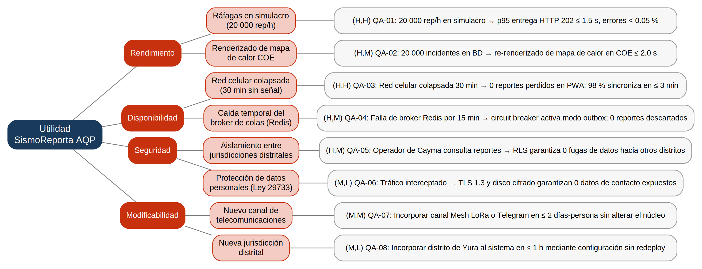

# Árbol de Utilidad y Priorización de Escenarios de Calidad (E1)

**Sistema:** SismoReporta AQP  
**Asignatura:** Construcción de Software (2026-B)  
**Grupo:** Grupo 08 — Santiago Palma (`santiagopalma12`) y Dario Rafael Cornejo Hurtado (`darich1010`)  
**Detonante / Escenario de Crecimiento:** *Simulacro nacional con 20,000 reportes en 1 hora bajo red móvil congestionada.*

---

## 1. Estructura del Árbol de Utilidad

El árbol de utilidad organiza los requerimientos no funcionales del sistema en cuatro atributos de calidad fundamentales (**Rendimiento**, **Disponibilidad**, **Seguridad** y **Modificabilidad**), refinando cada uno en subcategorías y escenarios concretos de seis partes con medidas cuantificables.

---

## 2. Escenarios de Calidad de Seis Partes

### Atributo: Rendimiento (Performance)

1. **QA-01 (H, H) — Latencia de aceptación en ráfagas de simulacro nacional:**
   - **Fuente:** 20,000 ciudadanos afectados en el radio provincial de Arequipa.
   - **Estímulo:** Envío masivo concurrente de reportes con fotos geolocalizadas durante la primera hora del simulacro telúrico (tasa promedio de 16–20 req/s con picos de 300 req/s al restablecerse antenas).
   - **Entorno:** Servidor backend bajo carga máxima de emergencia (CPU $> 75\%$).
   - **Artefacto:** Reverse Proxy Nginx, API Gateway FastAPI y Buffer de Ingesta en memoria Redis.
   - **Respuesta:** El sistema valida la sintaxis y encola de inmediato el evento en Redis, emitiendo una respuesta rápida `HTTP 202 Accepted` al cliente.
   - **Medida:** **Latencia $p95 \le 1.5\text{ s}$** en la entrega del `HTTP 202` al cliente; **tasa de errores HTTP 5xx $< 0.05\%$**.

2. **QA-02 (H, M) — Renderizado y clusterización del mapa de calor COE:**
   - **Fuente:** Operador y coordinador del Centro de Operaciones de Emergencia (COE).
   - **Estímulo:** Consulta y filtrado geoespacial interactivo del mapa de calor de daños tras acumular 20,000 incidentes en el almacén de datos.
   - **Entorno:** Operación en tiempo real durante la evaluación del impacto post-sismo.
   - **Artefacto:** Módulo GIS, motor PostGIS e interfaz web del Tablero COE.
   - **Respuesta:** Agrupamiento de puntos de daño mediante índices espaciales GiST y proyección cartográfica de densidades de calor.
   - **Medida:** Tiempo de consulta y renderizado cartográfico **$\le 2.0\text{ s}$** para el 100% de los polígonos distritales.

---

### Atributo: Disponibilidad (Availability / Fault Tolerance)

3. **QA-03 (H, H) — Resiliencia ante colapso de la red celular (Offline-First):**
   - **Fuente:** Ciudadanos en distritos con antenas celulares dañadas o saturadas.
   - **Estímulo:** Registro de incidentes de colapso y personas atrapadas sin conexión a Internet (pérdida de paquetes $> 80\%$).
   - **Entorno:** Primeros 30 minutos post-terremoto con red móvil inaccesible.
   - **Artefacto:** PWA Cliente (Service Worker + almacenamiento local persistente en IndexedDB).
   - **Respuesta:** La aplicación resguarda localmente el payload y la foto comprimida, emite un acuse de recibo visual local al ciudadano y activa un worker de reintentos en segundo plano al detectar el evento `online`.
   - **Medida:** **0 reportes perdidos (100% preservación local)**. Al reconectarse, el **98% de reportes encolados sincronizan en $\le 3\text{ minutos}$**.

4. **QA-04 (H, M) — Falla temporal del broker de colas en memoria (Redis):**
   - **Fuente:** Subsistema interno de infraestructura en el VPS.
   - **Estímulo:** Falla transitoria del proceso Redis o reinicio por saturación de socket durante 15 minutos en el pico del sismo.
   - **Entorno:** Ingesta masiva activa de reportes ciudadanos.
   - **Artefacto:** Módulo de Transporte, Circuit Breaker (`ConCircuitBreaker`) y tabla transaccional `outbox_reportes` en PostgreSQL.
   - **Respuesta:** El Circuit Breaker detecta 3 fallas consecutivas, conmuta a estado `ABIERTO` y desvía la persistencia inmediata a la tabla outbox de la base de datos relacional para evitar descartes en cascada.
   - **Medida:** **0 reportes descartados** durante el apagón del broker; recuperación automática a estado `CERRADO` tras restablecerse Redis.

---

### Atributo: Seguridad (Security)

5. **QA-05 (H, M) — Aislamiento de datos y control de acceso entre distritos:**
   - **Fuente:** Operador distrital autenticado de Defensa Civil (ej. Municipalidad de Cayma).
   - **Estímulo:** Petición de consulta y despacho de brigadas sobre incidentes georreferenciados.
   - **Entorno:** Operación concurrente multizona en Arequipa.
   - **Artefacto:** API Backend y políticas de Row-Level Security (RLS) en PostgreSQL sobre la tabla `reportes`.
   - **Respuesta:** Filtrado automático a nivel de motor de base de datos utilizando el claim `distrito_id` validado en el token JWT.
   - **Medida:** **0 fugas de incidentes confidenciales** o derivaciones no autorizadas hacia brigadas de otras jurisdicciones; overhead de consulta por RLS $\le 10\text{ ms}$.

6. **QA-06 (M, L) — Cifrado y resguardo de datos personales sensibles:**
   - **Fuente:** Agente malicioso interceptando paquetes en la red o acceso no autorizado al disco del VPS.
   - **Estímulo:** Intento de exfiltración de números de teléfono y ubicaciones GPS de ciudadanos.
   - **Entorno:** Operación continua en red pública de telecomunicaciones.
   - **Artefacto:** Terminación TLS en proxy Nginx y volumen de base de datos cifrado con LUKS (AES-256).
   - **Respuesta:** Tráfico cifrado de extremo a extremo y datos en reposo inaccesibles sin llave criptográfica.
   - **Medida:** **0 credenciales o identificadores expuestos en texto plano** (Cumplimiento de la Ley Peruana N° 29733).

---

### Atributo: Modificabilidad (Modifiability)

7. **QA-07 (M, M) — Extensibilidad de canales de telecomunicaciones alternativos:**
   - **Fuente:** Arquitecto / Ingeniero de Software de SismoReporta AQP.
   - **Estímulo:** Necesidad de incorporar un canal de contingencia por radio digital Mesh LoRa o bot de Telegram.
   - **Entorno:** Sistema en producción sin detener el servicio de emergencias.
   - **Artefacto:** Puerto `ICanalDespacho`, patrón Adapter y factoría por registro `FabricaCanales`.
   - **Respuesta:** Creación del nuevo adaptador e inyección en el contenedor de dependencias sin modificar `ServicioSincronizacion`.
   - **Medida:** Implementación e integración del nuevo canal en **$\le 2\text{ días-persona}$**, requiriendo **0 modificaciones** en el código del dominio.

8. **QA-08 (M, L) — Adición ágil de nuevas jurisdicciones distritales:**
   - **Fuente:** Administrador del COE Región Arequipa.
   - **Estímulo:** Incorporación de un nuevo distrito periférico (ej. Yura o Chiguata) a la red de respuesta sísmica.
   - **Entorno:** Plataforma operando normalmente.
   - **Artefacto:** Tabla de metadatos `distritos` y geocercas poligonales en PostGIS.
   - **Respuesta:** Alta mediante registro administrativo en base de datos.
   - **Medida:** Nuevo distrito plenamente operativo en el sistema en **$\le 1\text{ hora}$**, sin desplegar código nuevo ni reiniciar contenedores.

---

## 3. Matriz de Priorización y Corrección del Equipo frente a la IA

| ID Escenario | Atributo | Propuesta Inicial IA | Calificación Final Equipo | Justificación Técnica del Cambio |
| :---: | :---: | :---: | :---: | :--- |
| **QA-01** | Rendimiento | **(H, H)** | **(H, H)** | **Ratificado:** Atributo crítico ante el simulacro nacional; exige absorción de picos extremos bajo restricción de un solo VPS de \$15 USD/mes. |
| **QA-02** | Rendimiento | **(H, M)** | **(H, M)** | **Ratificado:** Clave para la toma de decisiones en el COE; la clusterización espacial requiere índices eficientes. |
| **QA-03** | Disponibilidad | **(H, H)** | **(H, H)** | **Ratificado:** Misión crítica; la red móvil colapsa y no se toleran reportes perdidos. |
| **QA-04** | Disponibilidad | **(H, M)** | **(H, M)** | **Ratificado:** Protege contra fallas del broker volátil mediante Circuit Breaker y persistencia outbox. |
| **QA-05** | Seguridad | **(H, M)** | **(H, M)** | **Ratificado:** Aislamiento interjurisdiccional indispensable para la gobernanza de Defensa Civil. |
| **QA-06** | Seguridad | **(H, H)** *(Propuesto)* | **(M, L)** *(Corregido)* | **CORRECCIÓN DE IA:** La IA sobreestimó la dificultad como *(H,H)*. El equipo la redujo a *(M,L)* porque TLS 1.3 y el volumen LUKS ya forman parte de la infraestructura base del Laboratorio 04; no demanda rediseño arquitectónico adicional. |
| **QA-07** | Modificabilidad | **(M, M)** | **(M, M)** | **Ratificado:** El desacoplamiento logrado con el patrón Strategy del Lab 07 reduce el esfuerzo a crear un simple adaptador. |
| **QA-08** | Modificabilidad | **(M, L)** | **(M, L)** | **Ratificado:** Configuración puramente declarativa basada en registros de base de datos. |
